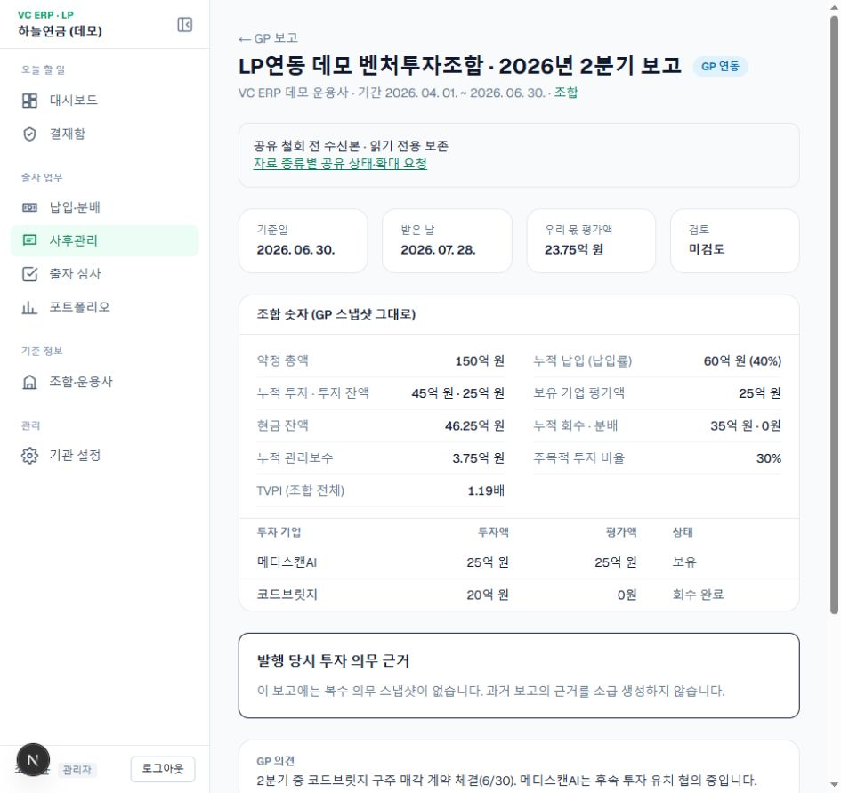
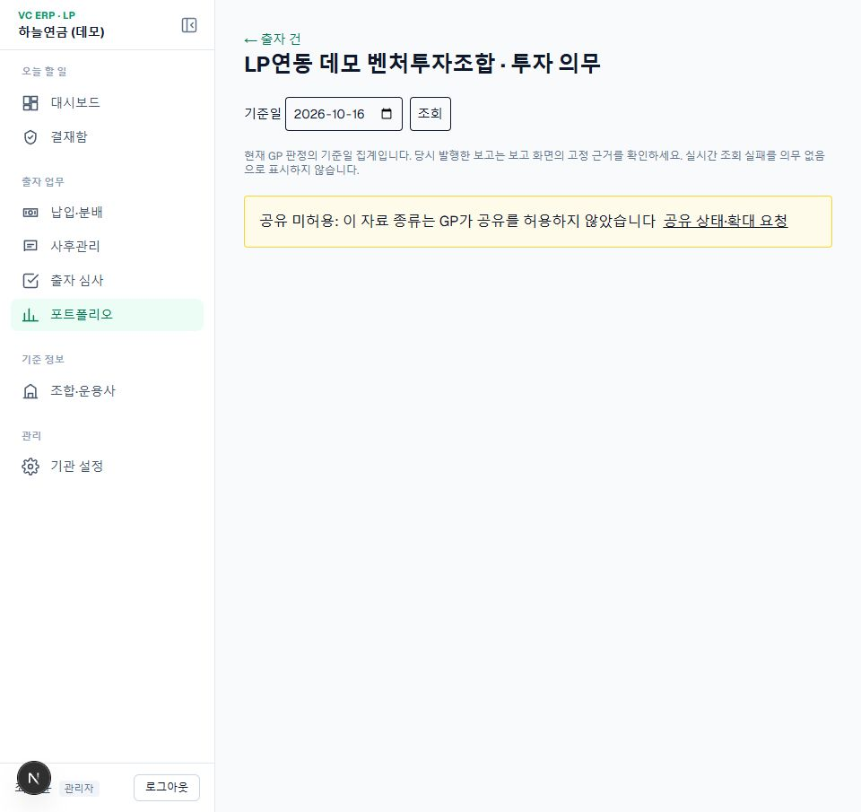
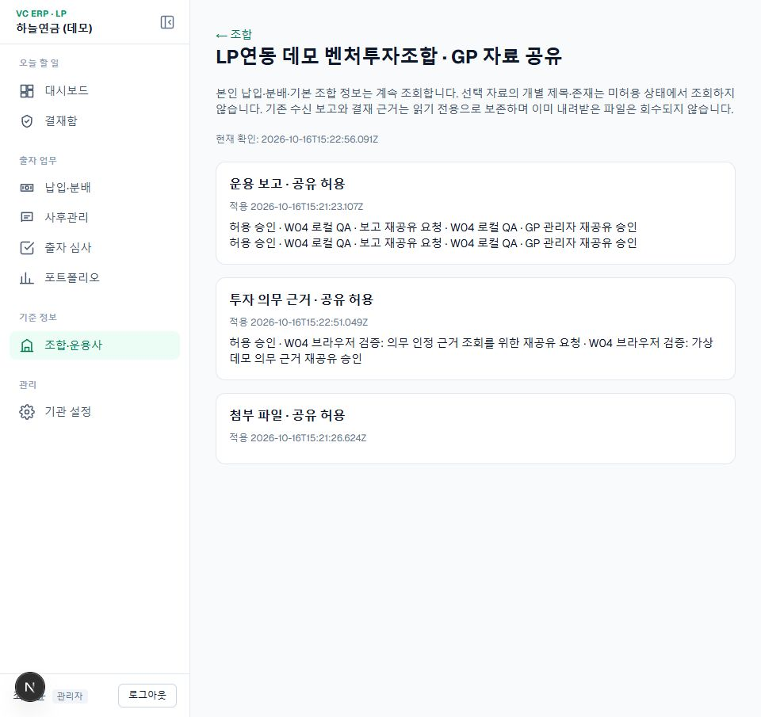

# W04 공유 상태와 철회 전 수신본 (2026-10-17)

사용자 결정 L61: 기관×조합×자료 종류. 필수 원장·기본 정보는 유지하고 보고·의무·첨부는 GP 관리자 허용 대상이다. 기존 공개 범위를 이관하며 새 연결은 선택 자료 미허용이다. 철회 전 수신 보고와 결재 근거는 기관 내부에 읽기 전용 보존하고 GP 최신 조회·새 수신·첨부 다운로드를 차단한다. 이미 내려받은 파일은 회수하지 않는다.

## 구현

- 개발 DB `012_fund_sharing.sql`: 기관별 공유 상태 캐시. 원본 권한은 GP이며 캐시는 허용 근거로 쓰지 않는다.
- `/funds/[fundId]/sharing`: 자료 종류별 상태·확인 시각·요청·승인 결과. 비공개 개별 문서 제목·존재는 표시하지 않는다. GP 장애 시 이전 상태임을 표시한다.
- API `/api/v1/funds/[fund_id]/sharing`, `/sharing/requests`. 기관 소유 조합을 먼저 확인한다. GP 미허용은 403으로 전달한다.
- 동기화는 보고 미허용을 건너뛰며 필수 원장을 계속 처리한다. 공유 상태 이벤트 수신 시 현재 권한을 다시 조회한다.
- 기존 보고는 수신본으로 조회 가능하다. 새 검토·준법 점검은 GP 현재 권한을 확인하고 철회 시 409로 막는다. 첨부 링크와 서버 프록시에도 권한을 적용한다. 기존 승인·보고 스냅샷은 보존한다.
- GP 서버/마이그레이션을 먼저 배포해야 한다. 실제 배포는 하지 않았다. 롤백 시 캐시·수신본·감사 기록을 삭제하지 않는다.

## 검증

LP `scripts/qa-sharing.mjs`: [16건 API 결과](qa-reports/2026-10-17-w04-api.json). GP 도메인 11건 통과. 양쪽 lint·타입·프로덕션 빌드 통과.

Chrome에서 철회된 보고 보존, 의무 미허용, 요청 제출, GP 관리자 승인, 재공유 조회를 확인했다. 기존 허용 상태로 복구했다. 테스트 요청·승인·변경 이력은 보존한다.

실제 첨부 다운로드 성공과 GP 장애 주입은 미실행이다. 첨부 미허용 시 파일 존재 조회보다 먼저 403이 발생함은 검증했다. 실제 규약·금융 산식 검증 완료와는 별개다.
