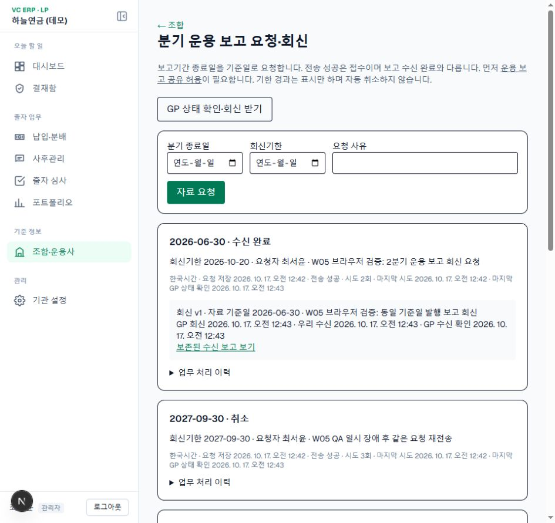
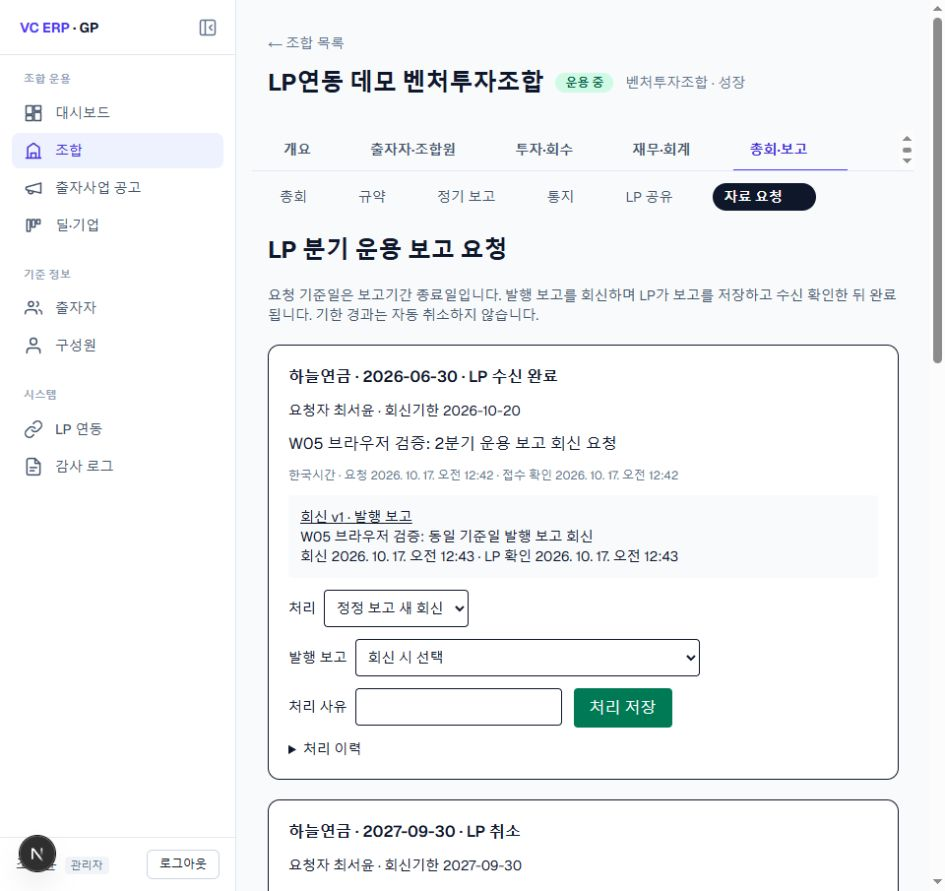

# W05 분기 운용 보고 요청·회신 (2026-10-17)

## 사용자 결정 L62

분기 운용 보고·기간 종료일 기준. 진행 중 중복 요청 차단, 기한 경과 표시만, 첫 수신 완료 전 취소, GP 회신 불가 사유, 완료 후 정정 회신 새 버전·이전 보존, W04 운용 보고 공유 허용 선행을 사용자가 선택했다.

## 구현

개발 DB `013_report_requests.sql`: 기관별 요청 아웃박스·GP 상태 캐시·보고 수신 연결. 요청자·기준일·회신기한·사유·전송 시도·오류·마지막 GP 확인·회신 버전·로컬 보고·우리 수신·GP 수신 확인 시각을 별도로 저장한다. 화면 시각은 한국시간이다.

`/funds/[fundId]/report-requests`와 같은 경로의 `/api/v1` API. POST 요청 생성, PUT 상태 확인·회신 수신, 하위 요청 POST 취소/재전송. 기관 ID와 GP 출자자 ID는 로그인 기관의 연결에서 구하며 입력으로 받지 않는다. 담당자/관리자만 쓴다.

전송 상태 pending/sent/rejected와 업무 상태 requested/acknowledged/replied/received/unavailable/cancelled를 분리한다. 전송 성공은 완료가 아니다. 일시 장애는 요청을 보존하고 1분·5분·30분·2시간 후 재시도, 5회 후 수동 재전송한다. 업무 거절·공유 미허용은 자동 재시도하지 않는다. 정기 cron, 기존 GP 이벤트 처리, 화면의 상태 확인이 재시도를 수행한다. 실제 주기는 배포 cron 일정에 의존한다.

회신 보고를 기존 `upsertGpReports`로 저장한 뒤 로컬 수신 연결을 만들고 GP 최신 회신 ID를 확인한다. 응답 유실은 같은 회신 ID로 재확인한다. 웹훅과 수동 수신이 겹치는 보고 저장은 조합 행 잠금으로 직렬화한다. 정정 전 보고와 회신 연결은 보존한다. 회신 수신 중 공유 철회는 완료로 처리하지 않는다.

GP 마이그레이션·서버를 먼저 배포해야 한다. 실제 배포·push는 하지 않았다. 과거 보고·회신·수신 이력을 삭제하는 롤백은 하지 않는다. [GP 전이·API 설명](https://github.com/choby-pm/vc-erp-gp/blob/main/docs/103_report_requests.md).

## 검증

- `node --env-file=.env.local scripts/qa-report-requests.mjs`: [20건 API 결과](qa-reports/2026-10-17-w05-api.json). 날짜·분기말·기관 격리·중복·멱등·보고 일치·수신 후 완료·정정 v2·원본 보존·취소·회신 불가·실제 접속 장애 주입/복구. 로컬 QA 정정 발행 보고와 감사 기록을 남긴다.
- `node scripts/check-report-request-boundaries.mjs`: 동시 수신 2회와 공유 미허용 업무 거절, 원래 공유 허용 상태 복구를 추가 검증한다.
- Chrome 실제 화면: LP 요청→GP 접수·담당 지정→발행 보고 선택 회신→LP 수신 완료→GP 완료 표시. 양쪽 lint·타입·프로덕션 빌드 통과.

최초 GP 조회 역할 HTTP 테스트는 데모 로그인 API가 역할 입력을 받지 않아 테스트가 잘못됐고, 권한 규칙 검사와 미로그인 HTTP 401로 교체했다. W05 조회 역할 실제 HTTP 검증과 배포 cron 시간 경과 재시도는 미실행이다. 실제 금융·규약 검증 완료로 간주하지 않는다.
